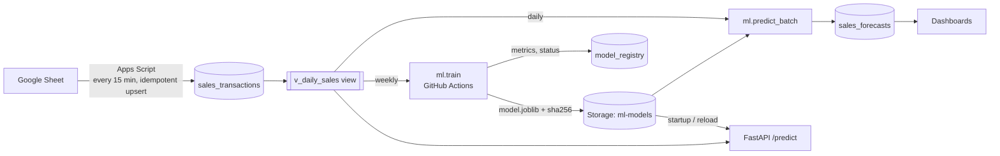

# Sales Forecasting & ML System

Google Sheets → Supabase (Postgres) → LightGBM → FastAPI, with scheduled retraining,
a promotion gate and automated rollout via GitHub Actions.

Built around the real sheet layout:

| Date | Location | Category | Bill No. | IMEI | Brand/Item | Model | Capacity | Colour | Sales Rep | Revenue | Cost | Profit |
|---|---|---|---|---|---|---|---|---|---|---|---|---|

**What it forecasts (default):** daily **revenue** per **location × category**
(e.g. `ISEVEN | ACCESSORIES`) for the next **14 days**. Item-level forecasting is
deliberately not the default: free-text items like `TEMPERED` or `BACKCASE` are too
sparse per day to forecast reliably. See [Customising](#customising).



## Repository layout

```
apps_script/sync_to_supabase.gs   Sheet → Supabase sync (validation, batching, retries, delete reconcile)
apps_script/appsscript.json       Apps Script manifest (V8, scopes)
supabase/schema.sql               Tables, view, RLS, grants, RPCs, storage bucket (idempotent)
supabase/tests/                   SQL behaviour tests (run in CI against Postgres 17)
ml/config.py                      Typed settings (env / .env)
ml/supabase_client.py             httpx PostgREST + Storage client (pagination, retries, upsert)
ml/data_loader.py                 Daily aggregates from Supabase or a CSV export of the sheet
ml/features.py                    Leakage-free calendar / holiday / lag / rolling features
ml/model.py                       sklearn Pipeline: category aligner + LightGBM (Tweedie)
ml/forecasting.py                 Recursive multi-step forecasts, seasonal-naive baseline, backtests
ml/train.py                       Train → backtest → gate → upload → register → promote
ml/predict_batch.py               Forecasts → sales_forecasts (idempotent upsert)
ml/registry.py                    Model bundle, SHA-256 verification, registry access
api/main.py, api/schemas.py       FastAPI service (lifespan model load, /health, /predict, /admin/reload)
.github/workflows/ml_pipeline.yml Weekly retrain, daily forecasts, gated rollout
.github/workflows/ci.yml          Lint, pytest, Apps Script tests, schema tests, Docker build
scripts/make_sample_data.py       Synthetic data in the sheet's exact format
tests/                            46 pytest tests + Node harness for the Apps Script
docs/DEPLOYMENT.md                Render / Cloud Run / Railway
docs/VERIFICATION.md              Step-by-step verification checklist
docs/DASHBOARD.md                 Phone-friendly dashboard on GitHub Pages (setup + privacy)
dashboard/index.html              The dashboard page (no data or secrets inside)
.github/workflows/dashboard.yml   Publishes the dashboard to GitHub Pages
```

## Quick start (local, no Supabase needed)

```bash
python -m venv .venv && source .venv/bin/activate     # Python 3.12+ (3.13 recommended)
pip install -r requirements-dev.txt
make train-local          # generates data/sample_sales.csv, trains, prints metrics
make serve-local          # http://localhost:8000/docs
curl -s -X POST localhost:8000/predict -H 'content-type: application/json' \
  -d '{"series":[{"location":"ISEVEN","category":"ACCESSORIES"}],"horizon":7}'
make test && make test-apps-script
```

## Production setup

### 1. Supabase
1. Create a project (region close to you, e.g. Singapore / Mumbai for Sri Lanka).
2. SQL editor → paste and run **`supabase/schema.sql`**. It is safe to re-run.
3. Project Settings → API Keys → copy the project URL and a **secret key** (`sb_secret_…`).
   Legacy `service_role` JWTs also work, but Supabase is retiring them, so prefer
   the new secret keys. Every client here sends the key correctly for either type.

### 2. Google Sheets sync
1. In the sheet: **Extensions → Apps Script**. Paste `sync_to_supabase.gs`. Under
   Project Settings, enable *Show "appsscript.json"* and paste `appsscript.json`.
2. Project Settings → **Script properties**:

   | Property | Example | Notes |
   |---|---|---|
   | `SUPABASE_URL` | `https://abcd.supabase.co` | required |
   | `SUPABASE_SERVICE_ROLE_KEY` | `sb_secret_…` | required; never put it in code |
   | `SHEET_NAMES` | `Sales` | comma-separated tabs (e.g. `Jul 2026, Aug 2026`) |
   | `HEADER_ROW` | `1` | |
   | `STRING_DATE_ORDER` | `DMY` | only used when a date is typed as **text** |
   | `BATCH_SIZE` | `500` | max 1000 |
   | `RECONCILE_MIN_RATIO` | `0.5` | safety guard for delete reconciliation |

3. Run `testConnection`, then `syncSales` (authorise when asked), then `installTriggers`.
   Reload the sheet to get the **Supabase Sync** menu.

**What the script adds to your sheet:** two hidden columns, `_row_id` (a permanent
UUID per line, which is the upsert key because `Bill No.` repeats across items in a
bill) and `_sync_hash` (change detection, so only edited rows are re-sent). Don't
delete them. Invalid rows are listed in a `_sync_errors` tab, and every run is logged
in `_sync_log`. Copy-pasted rows automatically get a new id.

> Make sure the **Date** column holds real dates (Format → Number → Date). Text
> dates are parsed using `STRING_DATE_ORDER`, and impossible dates are rejected.

### 3. GitHub
1. Push this repo. Add **Actions secrets** `SUPABASE_URL` and
   `SUPABASE_SERVICE_ROLE_KEY`, plus the deploy secrets from `docs/DEPLOYMENT.md`.
2. Create an environment named `production` (Settings → Environments). Add
   required reviewers there if you want a human to approve each run.
3. Actions → **ml-pipeline** → *Run workflow* (`train-and-forecast`) for the first model.

### 4. Deploy the API
See **[docs/DEPLOYMENT.md](docs/DEPLOYMENT.md)** (Render, Google Cloud Run, Railway).

### 5. Dashboard (optional)
Forecast vs actual on your phone, login-protected: see **[docs/DASHBOARD.md](docs/DASHBOARD.md)**.

### 6. Verify
Follow **[docs/VERIFICATION.md](docs/VERIFICATION.md)**.

## How the ML works

- **Data:** `v_daily_sales` aggregates in Postgres (revenue, profit, line items,
  bills per day × location × category). Python zero-fills missing days, because no
  accessories sold on a day is a real zero. **Today is never used**: it is still
  incomplete, so history ends yesterday (in `BUSINESS_TZ`) and today is forecast step 1.
- **Features** (`ml/features.py`): lags 1, 2, 3, 7, 14, 21, 28; rolling mean/std over
  7/14/28 days computed on `shift(1)`; same-weekday 4-week mean; recent zero-share;
  calendar features; Sri Lanka public and Poya holidays (`HOLIDAY_COUNTRY=LK`) incl.
  the day before and after. Tests prove that perturbing the future never changes past
  features, that series don't leak into each other, and that the short serving window
  reproduces the training features exactly.
- **Model:** one global LightGBM model across all series, with a Tweedie objective
  for zero-inflated, skewed sales. The category levels seen in training are frozen in
  the pipeline.
- **Validation:** strictly time-based. Early stopping uses the 28 days before the
  holdout. The last 28 days are a **rolling-origin backtest**: every 7 days it
  forecasts 14 days ahead recursively, using only data before that origin, which is
  exactly what production does. A **seasonal-naive** baseline (repeat last week) is
  scored on the same points.
- **Metrics:** MAE, RMSE, MAPE (over non-zero days; the share of excluded zero
  days is reported), **WAPE** (used for decisions) and bias, overall and by horizon
  week and category. They are written to `metadata.json`, `model_registry` and the
  GitHub job summary.
- **Promotion gate:** WAPE must beat the baseline by ≥ `MIN_IMPROVEMENT_VS_BASELINE`
  (5%) and must not be more than `MAX_REGRESSION_VS_PRODUCTION` (10%) worse than
  production's recorded WAPE. An optional `MAX_WAPE` adds a hard ceiling.
  Rejected models are still uploaded and registered with `status='rejected'` for audit.
- **Shipping:** after the gate, the model is refit on all data. The bundle
  (`model.joblib` = pipeline + feature config + column order + metadata) goes to the
  private `ml-models` bucket, and its SHA-256 is stored in `model_registry` and
  checked before every load.

## API

| Method | Path | Notes |
|---|---|---|
| GET | `/health` | status, readiness, `model_version`, training data end, uptime, history cache age |
| POST | `/predict` | `{"series":[{"location":"ISEVEN","category":"PHONES"}], "horizon":7}`; omit `series` for all active series. Requires `X-API-Key` if `API_KEYS` is set |
| POST | `/admin/reload` | `Authorization: Bearer $ADMIN_TOKEN`; loads the current production model without a restart (404 if `ADMIN_TOKEN` is unset) |

Errors: `422` invalid input or horizon > `MAX_HORIZON`; `503` stale data (sync broken
for more than `STALE_DATA_DAYS` days); `401` bad key/token. Every response carries
`x-request-id`, and logs are JSON lines.

## Customising

| What | Where |
|---|---|
| Sheet column names | `COLUMN_MAP` in `sync_to_supabase.gs` **and** `SHEET_HEADER_MAP` in `ml/data_loader.py` |
| Target metric | `TARGET_METRIC=revenue\|profit\|units` (units = line items; the sheet has no quantity column) |
| Horizon | `FORECAST_HORIZON` (batch), `MAX_HORIZON` (API) |
| Forecast entity | `SERIES_KEYS` in `ml/data_loader.py`, `SeriesRef` in `api/schemas.py`, the `group by` in `v_daily_sales` and the `sales_forecasts` columns |
| Holidays / weekend | `HOLIDAY_COUNTRY`, `FeatureConfig.weekend_days` |
| Gate strictness | `MIN_IMPROVEMENT_VS_BASELINE`, `MAX_REGRESSION_VS_PRODUCTION`, `MAX_WAPE` |
| Schedules | `cron` lines in `.github/workflows/ml_pipeline.yml` (UTC) |

## Security notes

- The secret/service key bypasses RLS. It lives only in Apps Script properties,
  GitHub secrets and the API host's env vars, never in code or a browser.
- RLS is enabled on every table. `anon` has no access at all. `authenticated` can
  only **read** `sales_forecasts` / `v_latest_forecasts` (for dashboards).
- Write-capable RPCs (`promote_model`, `finalize_sales_sync`) are revoked from
  `public`/`anon`/`authenticated`. Views use `security_invoker`.
- Model files are pickles. They are only loaded from the private bucket after
  SHA-256 verification against the registry.
- Set `API_KEYS` (or put the service behind your platform's IAM) before exposing
  `/predict` publicly.
